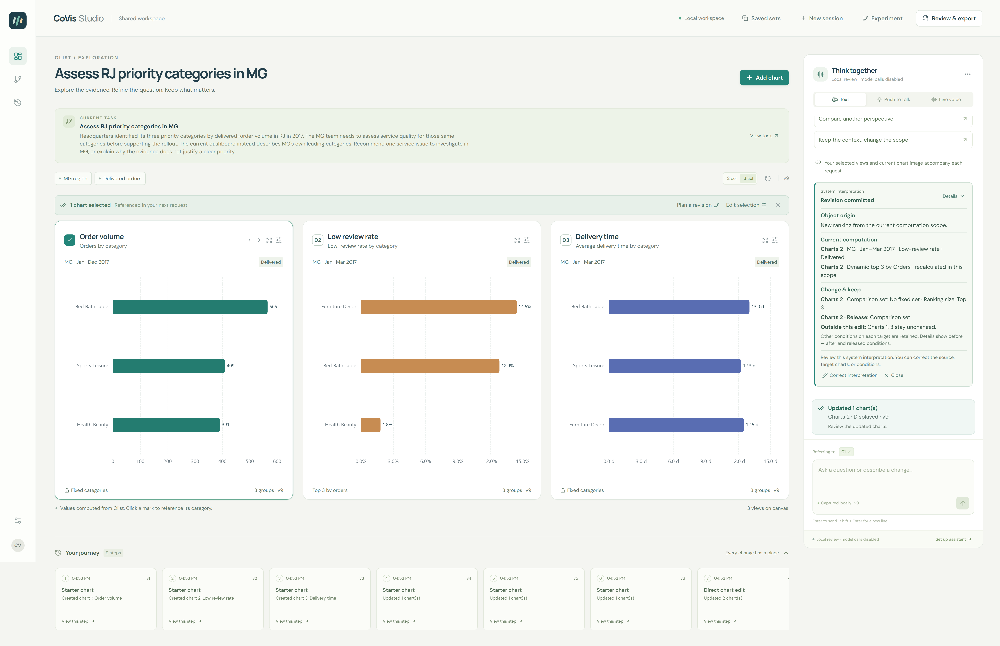

# CoVisStudio

An English-language workspace for revising analytical dashboards through continuous
voice conversation and direct interaction. Built with **Qwen Realtime, FastAPI,
Vue 3, ECharts and DuckDB**, using real Olist calculations.



*Illustrative local validation: the middle chart has a new ranking while the other
charts retain their category sets. This is not a participant-study result.*

## Research focus

A user can reuse categories from an earlier chart while retaining the current
region, period and measures, and changing only selected views. **Reusing old
evidence does not mean restoring the old analysis.**

CoVisStudio exposes the system's interpretation through object origin, current
computation, changes and retained conditions. Users can correct that interpretation
through the same chart tools used by the model.

The planned study compares **B0: strong direct editing** with **B2: explicit
revision support**. Both share full-duplex voice, models, tools, evidence access,
saved sets and execution rules. It tests the support package, not whether
full-duplex is superior to text or sequential voice. Participant effects and human
listening remain unverified.

The sole primary outcome is **terminal intent-consistency** (terminal committed
state vs. cumulative active intent); interface-assisted interpretation, the repair
funnel and interaction cost/time are secondary. See
[docs/amendments/A1-single-primary-2026-11-15.md](docs/amendments/A1-single-primary-2026-11-15.md).

## What works

- Select one or more charts and discuss or revise them while the assistant speaks.
- Query actual Olist data; numeric chart values cannot be overwritten by the model.
- Reuse exact historical category members or explicitly release them and rerank.
- Keep each target's current conditions and leave untargeted charts unchanged.
- Correct the source, target charts or conditions without mixing different measures.
- Inspect chart versions, saved sets, actual tool outcomes and audio recordings.
- Review independent human intent annotations and verify committed values with SQL.

The participant interface is designed for a 27-inch 4K monitor, including Windows
scaling at 1920 and 2560 CSS pixels. Rendered chart state and system interpretation
are distinct from user approval.

## Install and configure

Requirements: Python 3.11+, Node.js 20+, and the Olist CSV dataset.

```powershell
cd C:\CoVisStudio
python -m venv .venv
.\.venv\Scripts\python.exe -m pip install -e ".[dev]"
npm --prefix frontend ci
Copy-Item .env.example .env.local
```

Set `QWEN_API_KEY` in your local `.env.local`. Set `OLIST_DATA_DIR` to the dataset
folder and use the endpoint URLs belonging to your Qwen workspace. The supplied
example contains no credential. Do not overwrite an existing filled configuration
when updating an installation.

The voice model is `qwen3.8-omni-flash-realtime`; the text model is
`qwen3.8-omni-flash`. The application does not connect to a model on startup.
A connection starts only when you explicitly send text or start voice.

```powershell
.\start.ps1
```

Open **http://127.0.0.1:8066/**. To use an already-built frontend:

```powershell
.\.venv\Scripts\python.exe -m backend
```

## Use the workspace

1. Start with Olist or choose a business task.
2. Select chart numbers or data marks, then speak, type or use direct controls.
3. Open **Journey** to inspect a historical chart or **Saved sets** to reuse members.
4. In B2, inspect **System interpretation** and choose **Correct interpretation**
   when its source, targets or conditions differ from what you intended.
5. Review the actual changed charts. A spoken promise is not an executed edit.
6. End voice when finished. Chart state remains available for local inspection.

One process serves one active laboratory workspace. Live voice has a 60-second
budget; individual recorded input segments are limited to 10 seconds. There are
no automatic model retries or reconnects. Formal study tasks use one voice window
within 480 task seconds; the longer task timer does not extend the voice budget.

## Current verification

The current local provenance update records selected versus executed sources,
retains source identity through scope-only corrections, and clears it on reranking.
Continuous VAD fragments keep their initial reference binding. Independent intent
coding now distinguishes exact source requirements from membership-only requests.
These repairs have **not** been tested against a new real Qwen session. See
[source provenance changes and review entry points](docs/PROVENANCE_REVIEW.md).

A focused reuse-only check after the runtime-fact repair completed in **33.547 s**
with **4.24/6.64 s** inputs and no retry. The current request reissued the suppressed
tool, committed v7 and then reported completion; three final chart queries matched
independent SQL and the new image preceded the reply. One provenance discrepancy
remains: the model used v1 instead of selected v3, with identical category members.
The card reflects the executed source. This is a single authored case, not proof
of stable semantic reliability. API and the isolated test service were closed.

An earlier single-session reuse → Q1 correction → chart-2 reranking check
stopped after 56.360 seconds. It reproduced a false completion: an obsolete tool
call was correctly suppressed, but the current response claimed success without
another edit. The canvas remained at v6 and no revision card was produced; the
Q1 and reranking inputs were not reached. No retry occurred. See
[the delivery record](docs/REVISION_SUPPORT_DELIVERY.md). This failure is retained
separately from the earlier focused passes below.

Two earlier authored real-Qwen checks both completed:

| Diagnostic | Connection including cleanup | Input clips |
| --- | --- | --- |
| Release fixed members and rerank three views | 35.360 s | 4.24 / 8.08 s |
| Reuse historical members in two service views | 33.141 s | 4.24 / 6.64 s |

Both revisions occurred during assistant playback. Independent SQL matched 36
archived chart-query checks; each new chart screenshot was delivered before the
same request's following response; final output audio completed naturally.
No automatic retries or new TTS calls were made. Returned transcriptions still
contained errors. These checks establish specific runtime behavior, not model
visual comprehension, human listening or a B0/B2 treatment effect.

The local browser check covers correction, preserved measures, single-view
reranking, telemetry and 1920/2560/3840 layouts. See
[implementation and evidence](docs/REVISION_SUPPORT_DELIVERY.md) for scope and limits.

```powershell
.\.venv\Scripts\python.exe -m pytest -q
npm --prefix frontend test
npm --prefix frontend run build
.\.venv\Scripts\python.exe scripts\verify_revision_support_browser.py
```

Tests use local fixtures or authored Olist operations unless an explicit real-run
flag is supplied. Local tests do not contact paid model services.

The complete-flow driver now exports `video/recording-with-audio.mp4` after closing
the API. It mixes the injected user recordings with only the assistant samples
confirmed as played, retaining interruptions and silent gaps. This is an offline
reconstruction aligned to the traced browser clock and first video frame, not a
microphone recording of the room. The original silent video and WAVs remain intact.
Existing complete-flow archives can be converted without any API calls:

```powershell
.\.venv\Scripts\python.exe scripts\render_recording_audio.py traces\complete-flow-20261113\run
```

## Code and documentation

| Location | Responsibility |
| --- | --- |
| `backend/app.py`, `backend/providers.py` | Shared workspace, voice/text transport, permissions and committed feedback |
| `backend/revisions.py`, `backend/model_contract.py` | Evidence/current-scope edits and declared model-tool argument compilation |
| `backend/charts.py`, `backend/data.py` | Versioned charts and Olist computation |
| `backend/trace.py`, `backend/evidence.py`, `backend/delivery.py` | Input provenance, calibrated events and execution/playback observations |
| `backend/intent_scoring.py`, `backend/oracle.py` | Private human-intent locks, final-state scoring and independent SQL |
| `frontend/src` | Chart workspace, revision controls, audio and visibility observations |
| `paper` | Chinese and English review manuscripts and build sources |

- [Tool and application contract](docs/CONTRACT.md)
- [Unified research protocol](docs/UNIFIED_RESEARCH_PROTOCOL.md)
- [Formal study materials and analysis](docs/FORMAL_STUDY.md)
- [Current delivery](docs/REVISION_SUPPORT_DELIVERY.md)
- [Manuscripts](paper/README_BILINGUAL.md)
- [Task and verification history](TASKS.md)
- [Earlier implementation notes](docs/README_HISTORY_20261113.md)

Credentials, raw Olist data, runtime traces, audio and participant identities are
local-only and excluded from this repository. The local default data path is
`C:/VerbalVis/datasets/olist/data`; no other project is imported or modified.
